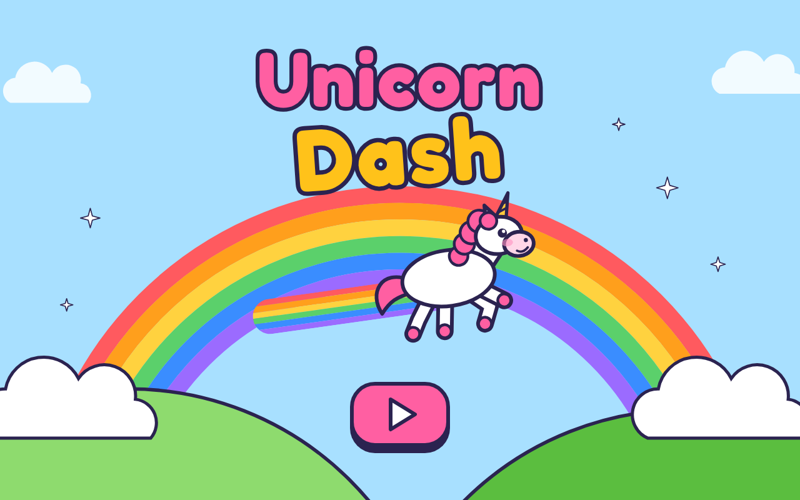

# Unicorn Dash 🦄

A rainbow running game for the browser. Your unicorn gallops across a sky world on her own. You only decide when to **jump** and when to **dash** on a rainbow, and try to make it to the castle.

**[▶ Play Unicorn Dash](https://jessicasogge.github.io/unicorn-dash/)**: works on computers, phones and tablets.



## What's here so far

The **start screen**, the **world map**, and all five worlds, the **Meadow**, **Candy Canyon**, **Cloud Kingdom**, the **Crystal Caves** and the **Night Sky**:

- **Tap the unicorn** on the start screen and she hops into a new mane color: pink, then blue, then yellow, then pink again. **Press Play** and she dashes off to the map, keeping her color.
- **On the map**, each world has its name under it. Tap a world (or its name) and she goes there. Tap the flower world (the **Meadow**), the lollipop world (**Candy Canyon**), the cloud world (**Cloud Kingdom**) the crystal world (the **Crystal Caves**) or the night world (the **Night Sky**) and it opens. The house button goes back to the start.
- **In the Meadow**, a small card comes first with the world's name and two buttons: **Go!** (or the space bar) and she runs on her own, or **How to play** to see the directions (a **quick tap** jumps, a **long tap** dashes, and what's new in that world) before pressing Go. **Tap** (or press space or the up arrow) to jump, and tap again in the air to jump higher, up to the gems on the clouds. **Hold** to rainbow dash across the long gaps. A dash lasts a little while, long enough for any gap; keep holding after that and she glides gently back down, and it takes letting go and pressing again to dash again (once each time she's up in the air). Every level has 20 rainbow-colored diamonds, and a counter at the top right counts them as she catches them. Catch every diamond and six fireworks go off behind the castle. Every world has something **prickly** on the ground to jump over, two or three of them, each with a diamond floating above it: thistles in the Meadow, spiky candies in Candy Canyon, grumpy thunderclouds in Cloud Kingdom, purple brambles in the Crystal Caves and starry blue brambles in the Night Sky. Run into one, or fall into a gap, and it's **game over**: try again from the start, or go back to the map. Reach the castle and "You beat the level!" comes up: play again, go back to the map, or go on to the next level.
- **In Candy Canyon**, it's the same, plus **gumdrops** in the ground: run onto one and she bounces up high, to diamonds in the sky. The sky and hills are pink, the ground is frosting on chocolate, and lollipop trees stand in the background.
- **In Cloud Kingdom**, run through a **paint pot** and her mane takes its color, one color after another. Each color has its own shape on its pot too (pink ♥, blue ★, yellow ☾).
- **In the Crystal Caves**, tall **crystal walls** only break for a rainbow dash: hold, and she smashes right through, the pieces flying. Run into one without dashing and it wobbles and knocks her back, onto solid ground, until she dashes. It's a dark purple cave with crystal-topped ground and glowing crystals in the background.
- **In the Night Sky**, the last world, there's a bit of everything (a gumdrop, a paint pot, a crystal wall) plus **shooting stars**: a gumdrop bounces her up to one, and she rides it across the sky, over a gap too wide even to dash, catching diamonds on the way. At the end of its trail she hops off onto the ground and the star zooms away. It's a deep blue starry night, teal at the horizon, with a crescent moon and moonlit green grass, and at its castle "You beat every world!" comes up.

On a keyboard, **Return** presses each screen's main button: Play on the start screen, the world she's on on the map, Go on a level's card, the next level at the castle (or play again, after the last one), and try again after a fall.

There are no stars or scores, and nothing is saved. There are a few words, like "Game Over", but reading isn't the point: everything you need to play is shown with pictures, and each button has a name for screen readers.

## The plan

- **One button, two moves.** Tap (or space or the up arrow) to jump, tap again in the air to double jump. Hold to **rainbow dash** for a little while: it bridges gaps and smashes crystal walls. Then she glides down until you let go and press again.
- **Mane magic.** Paint pots change her mane to pink ♥, blue ★ or yellow ☾. Every color has its own shape, so colorblind players can play too.
- **Five worlds**, each adding one new idea: Meadow, Candy Canyon (bouncy gumdrops), Cloud Kingdom (paint pots), Crystal Caves (dash-only walls) and Night Sky (everything, plus shooting stars).
- **Nothing to unlock.** Every world, level and unicorn in the **stable** is open from the start, and there are no stars or scores: nothing is saved. A fall into a gap is game over, and you try the level again from the start.

## Running it locally

The game is plain HTML, CSS and JavaScript in [`public/`](public/), with no build step. To run it with the included dev server:

```sh
npm install
npm run dev
```

Then open http://localhost:3006.

## Tests

```sh
npm test                # run the tests
npm run test:coverage   # run them and check how much of the game they cover
```

The tests use [Vitest](https://vitest.dev/). The game logic runs in [jsdom](https://github.com/jsdom/jsdom), a simulated browser page. The coverage check fails if the tests leave game code untested (the thresholds are in [`vitest.config.js`](vitest.config.js)), and the deploy runs it, so untested code doesn't ship.

## Project layout

| Path | What's there |
|---|---|
| `public/index.html` | The start screen |
| `public/script.js` | The start screen's taps: a new mane color, and Play |
| `public/world-map.html` | The world map: the five worlds |
| `public/game/world-map.js` | Puts her on the map, with the mane she came with, and moves her to the world you tap |
| `public/meadow.html`, `public/candy.html`, `public/cloud.html`, `public/crystal.html`, `public/night.html` | The Meadow, Candy Canyon, Cloud Kingdom, the Crystal Caves and the Night Sky, the five worlds |
| `public/game/level.js` | Draws a level and runs her through it: the controls, the camera, the castle. Each level page names its course (`data-level`) and the level after it (`data-next`) |
| `public/game/runner.js` | Her running, jumping, dashing and bouncing, paint pots, crystal walls, shooting stars and prickly things, with no drawing: speeds, gravity, diamonds |
| `public/game/course.js` | Each level's course: where the ground, gaps, clouds, gumdrops, paint pots, crystal walls, prickly things, shooting stars and gems are |
| `public/game/unicorn.js` | The unicorn's drawing and her three mane colors, in one place |
| `public/styles.css` | How every screen looks, and the hop and dash animations |
| `test/` | Tests |
| `src/index.ts` | Small Express server for local development |

## Deployment

Every push to `main` runs the tests and the coverage check and, if they pass, publishes `public/` to GitHub Pages (see [`.github/workflows/pages.yml`](.github/workflows/pages.yml)).

## Contributing

Bug reports, ideas and fixes are welcome! See [CONTRIBUTING.md](CONTRIBUTING.md) for how to get started, and please follow the [Code of Conduct](CODE_OF_CONDUCT.md).

## License

Unicorn Dash is released under the [MIT License](LICENSE). It uses the [Fredoka](https://github.com/hafontia/Fredoka-One) and [Nunito](https://github.com/googlefonts/nunito) fonts, under the SIL Open Font License ([`public/fonts/`](public/fonts/)).

## Credits

Made by Jessica Sogge. 
